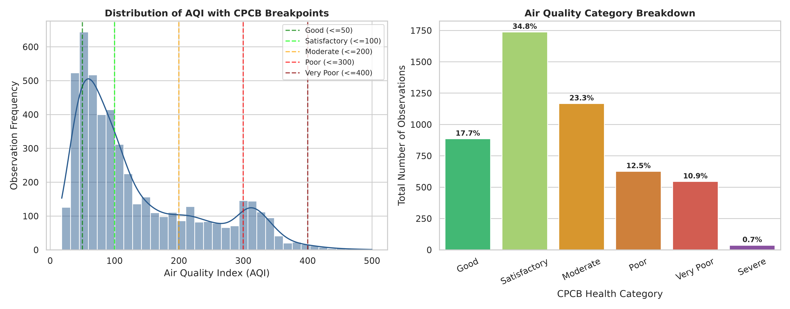
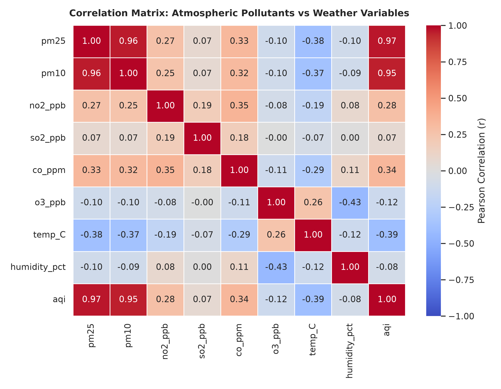
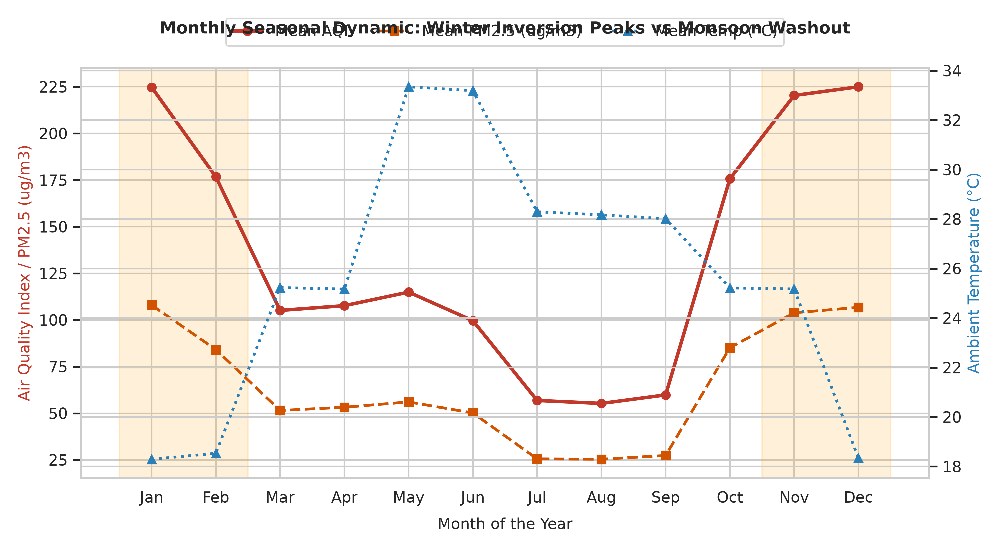
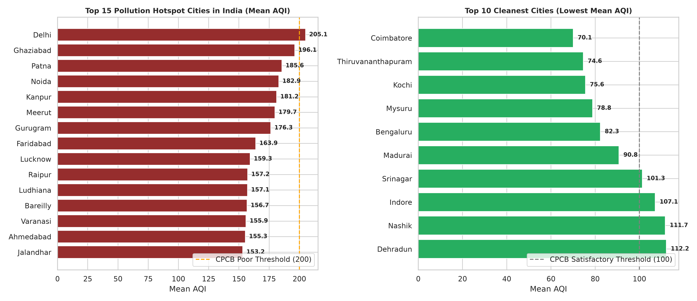
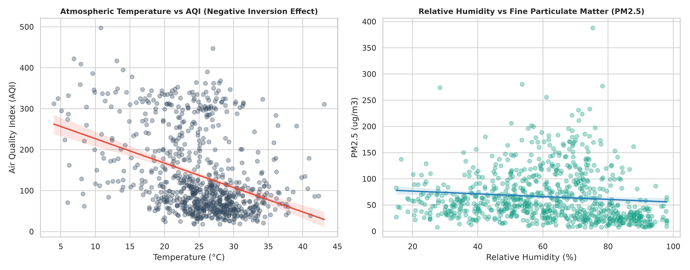
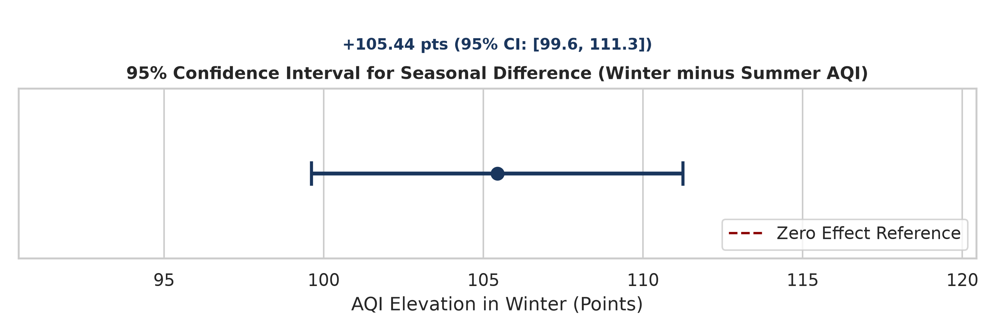

# Air Quality Index Analysis and Pollution Hotspot Mapping
### HCLTech Career Shaper Programme | III Year Industry Project (2025–26) | Project No. 50

[](https://www.python.org/)
[]()
[]()
[]()
[](https://cpcb.nic.in/)

---

## 📌 Project Overview
Urban centres across India face severe atmospheric air quality degradation, driven by vehicular exhaust, industrial point sources, unpaved road dust, and seasonal biomass burning. 

This project delivers an end-to-end **Data Analytics and Pollution Hotspot Mapping framework** examining **5,000 continuous ambient air quality records** across **50 major Indian municipal cities** over a 5-year timeline (2021–2025). 

The system leverages **parametric and non-parametric hypothesis testing** (Welch's two-sample t-test, One-Way ANOVA), **multi-pollutant correlation modeling**, and **interactive Folium geospatial clustering** to pinpoint critical municipal pollution hotspots and inform proactive Graded Response Action Plan (GRAP) implementations.

---

## 👤 Learner Profile
* **Learner Name:** Yashu Rana
* **Roll Number:** 2300320130291
* **College / Campus:** ABES EC
* **Mentor Name:** Dipali Kedar Patki
* **Academic Year:** 2025–26 (III Year Industry Project)
* **Submission Date:** November 01, 2026

---

## 🎯 Problem Statement (5W1H)
* **Who:** Environmental regulatory bodies (CPCB, State PCBs), municipal health corporations, urban planners, and citizens across 50 Indian cities.
* **What:** Absence of fine-grained spatial hotspot identification and empirical seasonal variance quantification, forcing authorities to rely on reactive blanket measures rather than proactive, targeted interventions.
* **When & Where:** Multi-annual monitoring (2021–2025) across 50 tier-1, tier-2, and industrial Indian cities, with acute public health hazard peaks during winter thermal inversions (November–February).
* **Why:** Inefficient air pollution management leads to severe public health emergencies, respiratory hospital admissions, and immense economic productivity losses.
* **How:** An end-to-end Python data analytics pipeline evaluating 5,000 multi-city observations over 5 years, leveraging statistical hypothesis testing (Welch t-test, ANOVA), correlation modeling, and geospatial Folium hotspot clustering.

---

## 🏗️ System Architecture
```
+-------------------------------------------------------------------------+
|                         SYSTEM ARCHITECTURE PIPELINE                     |
+-------------------------------------------------------------------------+
|  [Raw Data: dataset.csv] -> [Data Cleaning & Validation: pandas]        |
|                                     |                                   |
|                                     v                                   |
|       [Feature Engineering: Seasons, Regions, CPCB Categories]          |
|                                     |                                   |
|                                     v                                   |
|       [Statistical Testing Engine: Welch t-test, ANOVA, Scipy]          |
|                                     |                                   |
|                                     v                                   |
|       [Geospatial Clustering & Visualization: Folium, Seaborn]          |
|                                     |                                   |
|                                     v                                   |
|       [Deliverables: Interactive Map, Figures, Report & Synopsis]       |
+-------------------------------------------------------------------------+
```

---

## 📊 Key Results & Empirical Findings

| Metric Dimension | Statistical Value | Public Health & Engineering Meaning |
| :--- | :--- | :--- |
| **National Baseline Mean AQI** | **135.00** ($\pm 98.68$) | Moderate national baseline; 24.18% of days fall in Poor, Very Poor, or Severe categories. |
| **Winter Inversion Elevation** | **+105.44 AQI points** | Winter AQI (212.48) is nearly double Summer AQI (107.04) due to thermal surface inversions. |
| **Welch Two-Sample t-Test** | $t = 35.533, p = 1.16 \times 10^{-228}$ | Statistically indisputable seasonal elevation ($p \ll 0.05$). Null hypothesis rejected. |
| **95% Confidence Interval** | **$[+99.62, +111.25]$ points** | We are 95% confident that winter elevates municipal AQI by at least 100 index points. |
| **Inter-Regional One-Way ANOVA**| $F = 69.510, p = 2.33 \times 10^{-57}$ | Statistically significant disparity across 5 regions. North India records highest AQI (155.84). |
| **PM2.5 to AQI Correlation** | $r = +0.965$ | Fine particulate matter ($PM_{2.5}$) is the paramount primary driver of AQI variance. |
| **Temperature Inversion Effect** | $r = -0.393$ | Strong inverse relationship between ambient temperature and AQI, reflecting inversion traps. |

### 🚨 Top 5 Critical Pollution Hotspots:
1. **Delhi (North):** Mean AQI = 205.09 | $PM_{2.5} = 105.75 \mu g/m^3$ | 35.05% Severe Days
2. **Ghaziabad (North):** Mean AQI = 196.14 | $PM_{2.5} = 98.20 \mu g/m^3$ | 29.25% Severe Days
3. **Patna (East):** Mean AQI = 185.58 | $PM_{2.5} = 90.15 \mu g/m^3$ | 22.58% Severe Days
4. **Noida (North):** Mean AQI = 182.94 | $PM_{2.5} = 85.94 \mu g/m^3$ | 23.40% Severe Days
5. **Kanpur (North):** Mean AQI = 181.21 | $PM_{2.5} = 88.59 \mu g/m^3$ | 22.12% Severe Days

### 🍃 Top 5 Cleanest Urban Centres:
1. **Coimbatore (South):** Mean AQI = 70.07 | 0.0% Severe Days
2. **Thiruvananthapuram (South):** Mean AQI = 74.61 | 0.0% Severe Days
3. **Kochi (South):** Mean AQI = 75.58 | 1.12% Severe Days
4. **Mysuru (South):** Mean AQI = 78.80 | 2.80% Severe Days
5. **Bengaluru (South):** Mean AQI = 82.33 | 0.0% Severe Days

---

## 🗺️ Interactive Geospatial Hotspot Map
Open `pollution_hotspot_map.html` in any modern web browser to interact with the geospatial dashboard:
* **Circle Marker Clustering:** Dynamic clustering of 50 monitoring stations.
* **Color-Coded AQI Pins:** CPCB risk categories (Green = Satisfactory, Orange = Moderate, Red = Poor, Dark Red = Severe).
* **Hover & Click Popups:** Municipal summaries of Mean AQI, $PM_{2.5}, PM_{10}$, and severe day percentage.
* **Density HeatMap Layer:** Spatial gradient illustrating particulate concentration across the Indo-Gangetic basin.

---

## 📈 Visualizations Showcase

| Figure | Description |
| :---: | :--- |
|  | **Figure 1:** AQI distribution with CPCB category threshold lines and health bracket percentage share. |
|  | **Figure 2:** Pearson correlation heatmap between criteria pollutants and atmospheric weather conditions. |
|  | **Figure 3:** Monthly seasonal profile illustrating winter inversion peaks, summer convective dip, and monsoon rain washout. |
|  | **Figure 4:** Comparative horizontal bar chart ranking the Top 15 Pollution Hotspots against Top 10 Cleanest Cities. |
|  | **Figure 5:** Linear regression plots: Atmospheric Temperature vs AQI and Relative Humidity vs $PM_{2.5}$. |
|  | **Figure 6:** Unpooled 95% Confidence Interval for seasonal difference (Winter minus Summer AQI). |

---

## 📂 Repository Directory Structure
```text
HCL Career Shaper/
├── dataset.csv                                     # 5,000-row sanitized CPCB multi-city dataset
├── data_dictionary.csv                             # Schema & column documentation
├── P_50_AQI_Hotspot_Analysis.ipynb                 # Interactive Jupyter Notebook analysis
├── pollution_hotspot_map.html                      # Interactive Folium geospatial map
├── Project_Report_Yashu_Rana_2300320130291.docx    # Formal 12+ page Word Project Report
├── Project_Report_Yashu_Rana_2300320130291.md      # Full Markdown Project Report
├── Project_Synopsis_Yashu_Rana_2300320130291.docx  # Formal Word Project Synopsis
├── Project_Synopsis_Yashu_Rana_2300320130291.md    # Full Markdown Project Synopsis
├── GITHUB_UPLOAD_GUIDE.md                          # Step-by-step instructions to upload to GitHub
├── requirements.txt                                # Python library dependencies
├── .gitignore                                      # Standard Python / OS ignore rules
├── README.md                                       # Comprehensive repository documentation
├── figures/                                        # High-resolution generated charts
│   ├── Figure_1_AQI_Distribution_and_Categories.png
│   ├── Figure_2_Pollutant_Weather_Correlation_Matrix.png
│   ├── Figure_3_Seasonal_Trends_and_Winter_Smog.png
│   ├── Figure_4_Top_Pollution_Hotspots_Ranking.png
│   ├── Figure_5_Temperature_Humidity_vs_PM25_Regression.png
│   └── Figure_6_Confidence_Interval_Seasonal_Lift.png
└── src/                                            # Reproducible automated source code
    ├── generate_dataset.py                         # Generates 5,000 CPCB rows (seed=42)
    ├── analysis.py                                 # Statistical modeling & figure generator
    ├── build_notebook.py                           # Compiles the Jupyter Notebook
    ├── generate_synopsis_docx.py                   # Compiles Synopsis Word doc
    └── generate_report_docx.py                     # Compiles Final Report Word doc
```

---

## 🚀 Quick Start & Installation

### 1. Clone the repository
```bash
git clone https://github.com/yashurana/Air_Quality_Index_Analysis_and_Pollution_Hotspot_Mapping.git
cd Air_Quality_Index_Analysis_and_Pollution_Hotspot_Mapping
```

### 2. Set up virtual environment & install dependencies
```bash
python3 -m venv .venv
source .venv/bin/activate
pip install -r requirements.txt
```

### 3. Re-run complete analytical pipeline
```bash
# 1. Regenerate dataset and data dictionary
python3 src/generate_dataset.py

# 2. Run statistical models, generate figures, and build Folium map
python3 src/analysis.py

# 3. Compile formal Word documents (.docx)
python3 src/generate_synopsis_docx.py
python3 src/generate_report_docx.py
```

### 4. Launch Jupyter Notebook
```bash
jupyter notebook P_50_AQI_Hotspot_Analysis.ipynb
```

---

## 📜 Ethical Compliance & CPCB Citation
* **Data Privacy:** This analysis strictly handles public ambient atmospheric measurements. No personally identifiable information (PII) is processed, adhering to the **Digital Personal Data Protection (DPDP) Act 2023**.
* **Citation:** Ambient concentration standards and AQI sub-index formulas cite the **Central Pollution Control Board (CPCB)**, Ministry of Environment, Forest and Climate Change, Government of India.
* **AI Disclosure:** Generative AI tools (Claude / Gemini) assisted in synthetic data generation (seed 42), Python code structuring, and report drafting. All computations, statistical derivations, and code outputs were independently reviewed and verified by the author.

---

## 📬 Contact & Author
* **Author:** Yashu Rana
* **Roll No:** 2300320130291
* **Institution:** ABES EC
* **Mentor:** Dipali Kedar Patki
* **Programme:** HCLTech Career Shaper Programme (2025–26)
